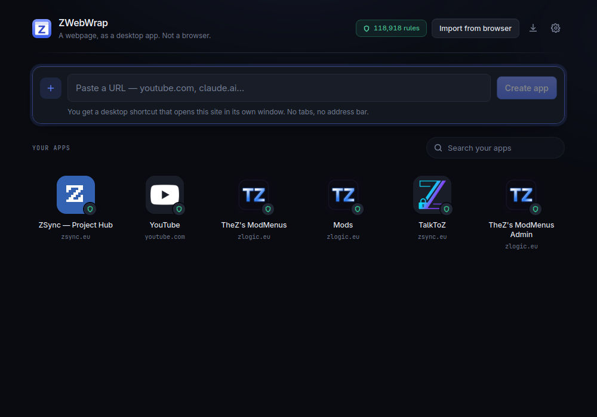
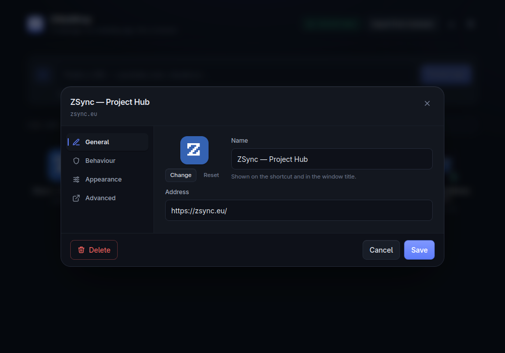
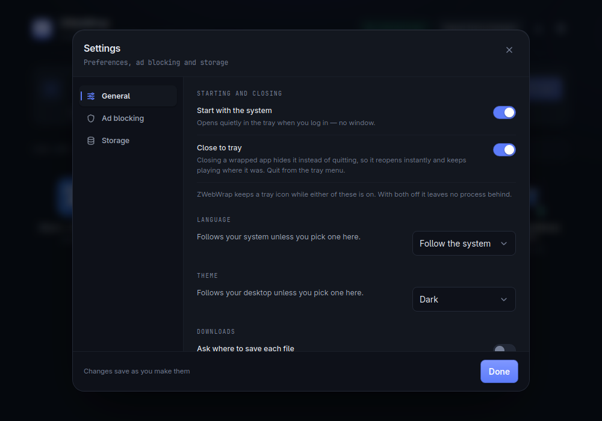
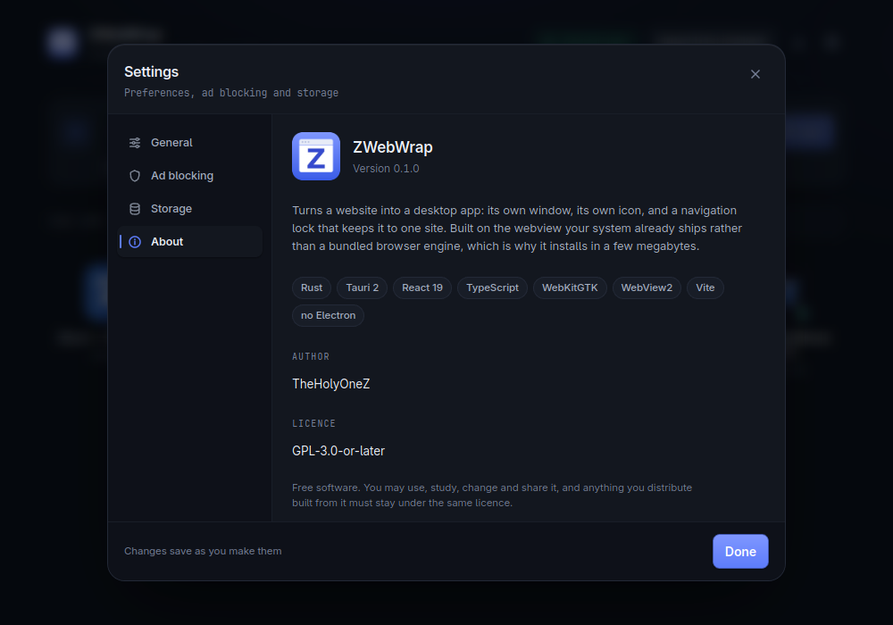

<div align="center">


<h1>ZWebWrap</h1>

<p>
  <b>Turn a webpage into a desktop app.</b><br>
  A shortcut, an icon, and a window locked to one site.<br>
  No tabs, no address bar, no browser.
</p>

<p>
  
  
  
  
  
</p>

</div>

---

<div align="center">
<table>
<tr>
<td align="center" width="33%">

**Not a browser**

One window, one site. Off-site links open in your real browser — but sign-ins
stay put.

</td>
<td align="center" width="33%">

**Real ad blocking**

A genuine filter engine — ~119,000 network rules, hidden ad slots, and partial
YouTube ad stripping.

</td>
<td align="center" width="33%">

**Actually small**

~15 MB. It uses the webview your system already has instead of shipping a
browser.

</td>
</tr>
</table>
</div>

---

## What it looks like

<div align="center">



<sub><b>Your library.</b> Paste a URL, get an app. The pill top-right is the live
filter-rule count.</sub>

<br><br>



<sub><b>Per-app settings.</b> Four tabs — general, behaviour, appearance and
advanced — for one app alone.</sub>

<br><br>



<sub><b>Global settings.</b> Everything saves as you change it.</sub>

<br><br>



<sub><b>About.</b> What it is built on, who wrote it, and where the real
downloads live.</sub>

</div>

---

## Contents

- [What you get](#what-you-get)
- [Platform support](#platform-support)
- [Adding an app](#adding-an-app)
- [The app window](#the-app-window)
- [The manager](#the-manager)
- [Browser extension](#browser-extension)
- [General settings](#general-settings)
- [Per-app settings](#per-app-settings)
- [Ad blocking](#ad-blocking)
- [How it compares](#how-it-compares)
- [Limitations](#limitations)
- [Building and running](#building-and-running)

---

## What you get

Gmail, Discord, YouTube, Notion, a work dashboard — most of what we call "apps"
are websites. A browser tab gets lost among thirty others. An Electron wrapper
costs 150 MB and its own copy of Chromium. Chrome's "Install as app" is still
your browser, with no ad blocking and no per-app settings.

ZWebWrap gives you a real desktop app instead:

- A **shortcut in your app menu** and on your desktop, with the site's own icon
- A **window locked to one site** — a link somewhere else opens in your normal
  browser instead of turning the window into a browser
- **Ad blocking that actually works** — a real filter engine, not hand-written
  CSS. YouTube video ads are _partly_ handled; see [Limitations](#limitations)
- **Its own settings** per app: permissions, zoom, hotkey, window frame, custom
  CSS and JavaScript
- **One process for all of it.** Six wrapped apps do not mean six Chromiums
- **It never calls home.** No telemetry, no update check, no ZWebWrap server —
  there isn't one. It reaches the network for the ad filter lists, and for a
  page's own title and icon when you add it. Nothing else, ever

> [!WARNING]
> **Version 0.1.0 — there has been no release yet.** No downloads, no signed
> binaries. You can build it yourself; see
> [Building and running](#building-and-running).

---

## Platform support

|                                                  | Linux (X11) | Linux (Wayland) | Windows | macOS |
| ------------------------------------------------ | :---------: | :-------------: | :-----: | :---: |
| Shortcuts and icons                              |     ✅      |       ✅        |   ✅    |  ❌   |
| **Network ad blocking**                          |     ✅      |       ✅        |   ✅    |  ❌   |
| Ad hiding (cosmetic)                             |     ✅      |       ✅        |   ✅    |  ❌   |
| YouTube pre-roll ads _(partly — see below)_      |     ⚠️      |       ⚠️        |   ⚠️    |  ❌   |
| Downloads, with a list and open / show in folder |     ✅      |       ✅        |   ✅    |  ❌   |
| Permission prompts                               |     ✅      |       ✅        |   ✅    |  ❌   |
| **Find in page** (<kbd>Ctrl</kbd>+<kbd>F</kbd>)  |     ✅      |       ✅        |   ✅    |  ❌   |
| Spell check                                      |     ✅      |       ✅        |   ✅    |  ❌   |
| Per-app proxy                                    |     ✅      |       ✅        |   ✅    |  ❌   |
| **Stored website login**                         |     ✅      |       ✅        |   ✅    |  ❌   |
| Short right-click menu in wrapped windows        |     ✅      |       ✅        |   ✅    |  ❌   |
| Tray, autostart, global hotkeys                  |     ✅      |       ✅        |   ✅    |  ❌   |
| **Per-app taskbar icon and grouping**            |     ✅      |       ❌        |   ✅    |  ❌   |
| **Always on top**                                |     ✅      |       ❌        |   ✅    |  ❌   |
| **Fullscreen fills the window**                  |     ✅      |       ✅        |   ✅    |  ❌   |

**What this means in practice**

- **Windows** — everything in the table above works. The one thing that still
  differs is **off-site downloads**: a download hosted on another domain is
  handed to your browser rather than fetched in the window, so an authenticated
  one can fail there. See _Off-site downloads_ below.
- **Wayland** — a window cannot set its own icon, so wrapped apps group
  together; log in with X11 for per-app icons. Always-on-top is refused by most
  compositors, so the pin button may do nothing.
- **macOS** — not supported. The app says so rather than half-working.

ZWebWrap checks all of this on startup and lists whatever is missing in
**Settings → Storage**, so you never have to guess why a button did nothing.

---

## Adding an app

Four ways.

<table>
<tr><td width="26%"><b>Paste a URL</b></td>
<td>In the ZWebWrap window. Type <code>youtube.com</code> — no <code>https://</code> needed. It fetches the real name and icon and shows you a preview before creating anything.</td></tr>
<tr><td><b>Import your bookmarks</b></td>
<td>The <b>Import from browser</b> button reads bookmarks out of Chrome, Chromium, Brave, Edge, Vivaldi, Opera and Firefox, hides anything you have already wrapped, and lets you tick the ones you want. The fastest way to go from zero to ten apps.</td></tr>
<tr><td><b>The browser extension</b></td>
<td>One click on the page you are already looking at. See <a href="#browser-extension">below</a>.</td></tr>
<tr><td><b>The command line</b></td>
<td><code>zwebwrap --add youtube.com</code> creates the app and its shortcut without opening a window.</td></tr>
</table>

**What happens next.** The app appears in your library, a shortcut lands in your
app menu (and on your desktop, unless you turned that off), and the site's icon
is downloaded and used for both. Click the shortcut and the site opens in its
own window.

To remove one: right-click its tile → **Delete**. The shortcut and icon go with
it. The site itself is untouched.

---

## The app window

A wrapped app looks like a native app — just the site, and your desktop's
titlebar. No tabs, no address bar, no browser buttons taking up space.

Everything you would normally need from a browser is still there, in two places.

### The hover toolbar

**Move your pointer to the very top edge of the window** — the titlebar or the
top border — and a small bar slides down. Move away and it disappears. This is
where the controls live, so they cost no pixels while you are using the app.

<div align="center">

| Control                     | What it does                                                                                                                |
| --------------------------- | --------------------------------------------------------------------------------------------------------------------------- |
| **Back / Forward / Reload** | The three browser buttons you still want                                                                                    |
| **Zoom slider**             | 50% – 250%, remembered per app                                                                                              |
| **Pin**                     | Keep this window above all others                                                                                           |
| **Compact player**          | Shrink to just the video, resized to fit it and pinned on top. Ideal for YouTube beside your work — <kbd>Esc</kbd> to leave |
| **Volume**                  | Hover for a slider, click to mute. Linked to the site's own volume control, both ways                                       |
| **Downloads**               | Appears when this app downloads something. Click to open the file, shift-click to show it in its folder                     |
| **Copy address**            | The current page URL to your clipboard                                                                                      |
| **Open in browser**         | Hand this page to your real browser                                                                                         |
| **Find**                    | <kbd>Ctrl</kbd>+<kbd>F</kbd> opens a search box with next / previous                                                        |
| **Maximise / Close**        | Shown when you have turned the titlebar off                                                                                 |

</div>

The empty space in the middle of the bar is a drag handle, so you can still
move a window that has no titlebar. Double-click it to maximise.

### Keyboard

<div align="center">

<kbd>Ctrl</kbd>+<kbd>F</kbd> find ·
<kbd>F3</kbd> or <kbd>Ctrl</kbd>+<kbd>G</kbd> next match ·
<kbd>F5</kbd> or <kbd>Ctrl</kbd>+<kbd>R</kbd> reload ·
<kbd>Alt</kbd>+<kbd>←</kbd> back ·
<kbd>Alt</kbd>+<kbd>→</kbd> forward ·
<kbd>Ctrl</kbd>+<kbd>Shift</kbd>+<kbd>C</kbd> copy address ·
<kbd>Esc</kbd> leave compact player

</div>

### Right-click

Back, forward, reload, copy, copy link address, copy this page's address, open
in browser.

### What "locked to one site" means

A YouTube window stays on YouTube. Click a link to some blog and it opens in
your normal browser instead — the wrapped window never becomes a general
browser you have to manage.

Two exceptions, both deliberate:

- **Sign-ins stay in the window.** "Continue with Google", "Log in with
  Discord", two-factor steps, and the redirects between them are all followed
  in-window, so you actually end up logged into the app instead of into your
  browser.
- **Bot checks stay in the window.** Cloudflare and reCAPTCHA challenges are
  never sent away and never blocked.

You can widen the scope per app (add `youtu.be` to a YouTube app), or switch it
to "follow links here" if you want that one window to behave like a small
browser.

---

## The manager

The ZWebWrap window itself — your library.

- **Top bar** — a live ad-blocking status you can click for details, an
  **Import from browser** button, **Settings**, and a **downloads** button that
  appears once something has been downloaded: it lists what came in, with
  **Open** and **Show in folder**
- **Add box** — paste a URL, see a preview of the name and icon, create
- **Your apps** — a grid of tiles with each site's icon. Click to open,
  right-click for open / settings / copy address / toggle ad blocking / delete.
  A search box appears once you have more than four
- **Warnings** — if your system is missing the video plugins WebKit needs, it
  says so here along with the exact command to install them, instead of letting
  you discover that videos never play

A fresh install opens on a **seven-step tour** that points at each of these in
turn, plus the hover toolbar you would otherwise have to find by accident. Skip
it with Escape; run it again any time from **Settings → General**.

It follows your desktop's light or dark theme unless you pick one.

### Languages

The whole interface — every menu, hint and error — is translated into **twelve
languages**, each listed in its own name so somebody who has landed in the wrong
one can find their way out:

|          |            |         |           |
| -------- | ---------- | ------- | --------- |
| English  | Deutsch    | Español | Français  |
| Italiano | Nederlands | Polski  | Português |
| Türkçe   | Русский    | 日本語  | 中文      |

It follows your system's language by default; **Settings → General → Language**
overrides that. A region tag narrows to its base language, so `pt-BR` gets
Portuguese rather than falling back to English.

These are real translations rather than machine output left unchecked, and the
build refuses to publish a locale that has drifted: `check:i18n` fails if any
language is missing a string the English has, so a half-translated release
cannot ship.

---

## Browser extension

**Optional.** An add-on for Chrome and Firefox that wraps the tab you are
already on, so you do not have to retype its address. Everything it does can
also be done from the ZWebWrap window or the command line.

### What the popup gives you

Click the toolbar icon and you get:

- The current page's **name**, editable before you create anything
- A **Block ads and trackers** checkbox for the new app
- A **Create desktop app** button — the shortcut and icon appear immediately
- **Open &lt;app&gt;** as well, if you already wrapped this site
- A **list of your existing apps**, each one launchable straight from the popup
- The connected app's **version**, and a warning if the extension and the app
  are different versions

On a page that cannot become an app — a `chrome://` page, a PDF viewer — it
says so instead of offering a button that would fail. If the desktop app is not
installed or not reachable, it says that too, with the reason.

There is also a one-off **welcome page** on install, which checks whether the
desktop app is there and walks you through it if not.

### How it works

The extension is deliberately thin: it knows how to describe a tab and nothing
else. Everything else — the name, the icon, the shortcut — is the desktop app's
job, which is why it fetches the site's real icon rather than sending the page
favicon.

It talks to ZWebWrap over **native messaging**: your browser starts the app for
a single exchange and closes the pipe. Nothing runs in the background and no
port is opened. ZWebWrap registers itself with every browser you have installed
each time it launches, so **the desktop app must have been run at least once**
before the extension can reach it.

Chrome, Chromium, Brave, Edge, Vivaldi, Opera and Firefox are supported.

### Installing it

It is not in any store yet, so load it manually. Building the app also builds
the extension into `apps/extension/dist/` — or run `pnpm ext:build` on its own.

| Browser                                           | Steps                                                                                                                        |
| ------------------------------------------------- | ---------------------------------------------------------------------------------------------------------------------------- |
| **Chrome, Chromium, Brave, Edge, Vivaldi, Opera** | Open `chrome://extensions`, turn on **Developer mode**, click **Load unpacked**, and pick `apps/extension/dist`              |
| **Firefox**                                       | Open `about:debugging` → **This Firefox** → **Load Temporary Add-on**, and pick `manifest.json` inside `apps/extension/dist` |

Then launch ZWebWrap once so it can register the connection, and the popup will
find it.

---

## General settings

**Settings → General.** These save as you change them.

| Setting                              | Default            | What it does                                                                                                                                                       |
| ------------------------------------ | ------------------ | ------------------------------------------------------------------------------------------------------------------------------------------------------------------ |
| **Start with the system**            | Off                | Opens quietly in the tray when you log in — no window                                                                                                              |
| **Close to tray**                    | Off                | Closing a wrapped app hides it instead of quitting, so it reopens instantly and keeps playing where it was. Quit from the tray menu                                |
| **Language**                         | Follow the system  | Twelve languages, each shown in its own name                                                                                                                       |
| **Theme**                            | Follow the desktop | Light or dark. Affects this window only, never wrapped sites                                                                                                       |
| **Fullscreen fills the window**      | On                 | Clicking fullscreen on a video fills the wrapped window instead of taking the whole screen. Any app can override it                                                |
| **Ask where to save each file**      | On                 | Every download lands in Downloads and then asks where you want it kept. Turn it off for the browser behaviour: straight to Downloads, no question                  |
| **Guided tour**                      | —                  | The seven-step walkthrough shown once on a fresh install. The button runs it again                                                                                 |
| **Put new shortcuts on the desktop** | On                 | Apps always get an app-menu entry; this is the extra copy on your desktop. Changing it also tidies up apps you already made                                        |
| **Block ads in new apps**            | On                 | Applies to apps made from the URL box and from bookmark import. Apps you already made keep their own setting, and the extension asks per app with its own checkbox |

> ZWebWrap only keeps a tray icon while **Start with the system** or **Close to
> tray** is on. With both off it leaves no process behind after the last window
> closes.

**Settings → Ad blocking** shows the live rule count, which filter lists are
loaded, when they last updated, and an **Update now** button.

**Settings → Storage** shows your data folder (apps, icons, filter lists and the
login session shared by every app) with a button to open it — plus anything this
build cannot do on your machine.

---

## Per-app settings

Click a tile, or right-click → **Settings**. Four tabs.

<details open>
<summary><b>General</b></summary>

<br>

| Setting     | What it does                                                                                         |
| ----------- | ---------------------------------------------------------------------------------------------------- |
| **Icon**    | Change it to any image you like, or reset it to fetch the site's own again. The shortcut updates too |
| **Name**    | Shown on the shortcut and in the window title                                                        |
| **Address** | Where the app opens                                                                                  |

</details>

<details open>
<summary><b>Behaviour</b></summary>

<br>

| Setting                            | Default                                            | What it does                                                                                                                                                                                                                                                                                                                                                          |
| ---------------------------------- | -------------------------------------------------- | --------------------------------------------------------------------------------------------------------------------------------------------------------------------------------------------------------------------------------------------------------------------------------------------------------------------------------------------------------------------- |
| **Block ads and trackers**         | Full                                               | **Full** blocks requests and hides ad slots. **Network only** keeps requests blocked but injects nothing into the page — for a site that cosmetic filtering breaks, so you no longer have to give up request blocking to fix it. **Off** does neither                                                                                                                 |
| **Desktop shortcut**               | Follows the global setting                         | The copy on your desktop. The app-menu entry is always there                                                                                                                                                                                                                                                                                                          |
| **Fullscreen fills this window**   | Follows the global setting                         | Per-app override. Applies immediately, even to an open window                                                                                                                                                                                                                                                                                                         |
| **Window frame**                   | Normal                                             | **Normal**, **No border** (drops the resize edge — many themes have none anyway, so it may look the same), or **No titlebar** (the hover toolbar carries move, maximise and close)                                                                                                                                                                                    |
| **When a link leaves this site**   | Send to my browser                                 | Or follow it here. Sign-ins stay in-window either way                                                                                                                                                                                                                                                                                                                 |
| **Group**                          | None                                               | A free-text name. Apps sharing one appear together in your library under a heading, and in the tray under a submenu. Type a new name to create a group; it disappears when its last app leaves                                                                                                                                                                        |
| **Login session**                  | Shared                                             | **Shared** means one Google sign-in covers your wrapped YouTube, Gmail and Drive at once. **Separate** gives this app its own cookie jar, so you can be signed into a second account on the same service — a second Slack workspace, or work and personal Gmail side by side. A separate session starts logged out, and the change applies next time you open the app |
| **Also part of this app**          | Empty                                              | Extra domains that should open in-window — `youtu.be` for YouTube, an internal host for a work dashboard                                                                                                                                                                                                                                                              |
| **Proxy**                          | None                                               | Send this app's traffic through `host:port` or `socks5://host:port`. Setting one moves the app to its own login session — both engines attach a proxy to the session rather than the window, so on the shared one it would route every other app with it                                                                                                              |
| **Website login**                  | None                                               | A username and password for a site behind an HTTP password box, the kind an intranet dashboard uses. Sent on the first prompt only: if it is refused, the site's own box appears rather than retrying until the account locks. Stored in `credentials.json` in your data folder, in plain text — see [Limitations](#limitations)                                      |
| **Global shortcut**                | None                                               | A system-wide key combination that brings this app forward from anywhere, and sends it away when pressed again. Click the field and press the keys                                                                                                                                                                                                                    |
| **Show unread count in the title** | Off                                                | Mirrors `(3)` or `Inbox (12)` from the page title into the window title, so your taskbar shows it. For messaging apps                                                                                                                                                                                                                                                 |
| **Permissions**                    | Notifications: Allow<br>Mic, camera, location: Ask | **Allow**, **Ask** or **Block** for notifications, microphone, camera and location. "Ask" prompts once and remembers                                                                                                                                                                                                                                                  |

</details>

<details open>
<summary><b>Appearance</b></summary>

<br>

| Setting    | Default    | What it does                                                                           |
| ---------- | ---------- | -------------------------------------------------------------------------------------- |
| **Zoom**   | 100%       | 80% to 150%. The toolbar slider goes further, 50%–250%                                 |
| **Window** | 1200 × 800 | Read-only. Size, position and maximised state are remembered when you close the window |

</details>

<details open>
<summary><b>Advanced</b></summary>

<br>

| Setting              | Default | What it does                                                                                                                                                                                                         |
| -------------------- | ------- | -------------------------------------------------------------------------------------------------------------------------------------------------------------------------------------------------------------------- |
| **Browser identity** | Default | What this app tells websites it is, with one-click presets for Chrome, Firefox, Safari and iPhone. Keep the default unless a site rejects it — some do. iPhone gives you the mobile layout, handy in a narrow window |
| **Your CSS**         | Empty   | Injected before the page paints. For hiding something the site will not let you hide                                                                                                                                 |
| **Your JavaScript**  | Empty   | Runs at page start with the page's own privileges. It cannot reach ZWebWrap itself                                                                                                                                   |

</details>

Two more settings live on the hover toolbar rather than in this dialog, because
they belong to the window in front of you: **always on top** and **compact
player**. Both are remembered.

---

## Ad blocking

On by default, per app, and switchable from the right-click menu on any tile.
Each app can be set to **Full**, **Network only** or **Off** in its settings.

Three things happen:

1. **Requests are blocked before they leave** — roughly 119,000 rules from EasyList,
   EasyPrivacy and three uBlock Origin lists _(Linux only for now)_
2. **Leftover ad slots are hidden** before the page paints, so there is no empty
   box and no flash
3. **YouTube video ads are partly stripped** out of the player itself — not
   skipped, not fast-forwarded; where it works, the player never receives them.
   It does not always work: see below

Filter lists **update themselves every 4 days**, so blocking keeps working
without waiting for a new version of the app. You can also force an update from
**Settings → Ad blocking**.

CAPTCHAs and bot checks are never blocked, because breaking one does not hide an
ad — it locks you out of the site.

During development this scored 10/10 on d3ward's adblock test page. That page
has since been **archived by its author**, so the result is no longer
reproducible and is recorded here as history rather than as evidence. What
you can check yourself: **Settings → Ad blocking** shows the live rule count
and which lists are loaded, and each app's tile shows how many elements it
hid.

> [!WARNING]
> **YouTube pre-rolls are half-blocked — expect to see one sometimes.** Opening
> a video _from another video_ usually has no ad. Opening one **directly** — a
> link, a bookmark, the app's own start page — usually still plays a pre-roll.
>
> The reason is specific rather than general flakiness. YouTube sends the player
> response three ways; two of them are intercepted and the ad slots removed. The
> third is inlined into the page's own HTML on a fresh load, where it is script
> source rather than parsed JSON, so the hooks never see it. uBlock Origin
> handles that case with a `trusted-` scriptlet — one of 108 in the filter lists
> that the engine refuses to run by design.
>
> Everything else on this page is unaffected: banner and display ads on YouTube
> are still blocked and hidden. Confirmed by watching a real video, not by
> reading code.

---

## How it compares

|                                    |          ZWebWrap          |        Pake         |    Nativefier     | Ferdium / Rambox | WebCatalog  | Chrome "Install as app" |
| ---------------------------------- | :------------------------: | :-----------------: | :---------------: | :--------------: | :---------: | :---------------------: |
| Status                             |   0.1.0, **unreleased**    |       Active        | **Archived 2023** |      Active      | Commercial  |    Built into Chrome    |
| Size                               |         **~15 MB**         |       ~10 MB        |      150 MB+      |     150 MB+      |   150 MB+   |          Zero           |
| **Ad blocking**                    | ✅ **Real filter engine**  | ⚠️ Hand-written CSS |        ❌         |        ❌        | ⚠️ Claimed  |    ⚠️ Browser's own     |
| Self-updating filter lists         |             ✅             |         ❌          |        ❌         |        ❌        |     ❓      |            —            |
| Locked to one site                 | ✅ **incl. sign-in flows** |     ⚠️ Partial      |     ⚠️ Regex      |        ❌        |     ❌      |           ❌            |
| Per-app permissions                |             ✅             |         ❌          |        ❌         |        ❌        |     ❓      |           ⚠️            |
| Custom CSS / JS per app            |             ✅             |         ✅          |        ✅         |        ✅        |     ✅      |           ❌            |
| Unread badge                       |             ✅             |         ❌          |        ✅         |        ✅        |     ✅      |           ⚠️            |
| Global hotkey to summon            |             ✅             |         ❌          |        ❌         |        ✅        |     ✅      |           ❌            |
| Tray + close to tray               |             ✅             |         ❌          |        ✅         |        ✅        |     ✅      |           ❌            |
| Autostart                          |             ✅             |         ⚠️          |        ❌         |        ✅        |     ✅      |           ❌            |
| Compact / mini player              |             ✅             |         ❌          |        ❌         |        ❌        |     ❌      |         ⚠️ PiP          |
| Import bookmarks as apps           |             ✅             |         ❌          |        ❌         |        ❌        |     ❌      |           ❌            |
| Browser extension                  |             ✅             |         ❌          |        ❌         |        ❌        |     ✅      |            —            |
| App library GUI                    |             ✅             |       ⚠️ CLI        |    ❌ CLI only    |        ✅        |     ✅      |           ⚠️            |
| Find in page                       |             ✅             |         ✅          |        ✅         |        ✅        |     ✅      |           ✅            |
| **Multiple accounts per service**  |             ✅             |         ❌          |        ❌         |        ✅        | ✅ **paid** |       ⚠️ Profiles       |
| **Workspaces / grouping**          |             ✅             |         ❌          |        ❌         |        ✅        |     ✅      |           ❌            |
| **Developer tools**                |             ❌             |         ✅          |        ✅         |        ✅        |     ❓      |           ✅            |
| **DRM (Netflix, Spotify)**         |             ❌             |         ❌          |        ✅         |        ⚠️        |     ❓      |           ✅            |
| **Shareable standalone app files** |             ❌             |         ✅          |        ✅         |        —         |      —      |           ❌            |
| Cloud sync                         |             ❌             |         ❌          |        ❌         |        ✅        |     ✅      |           ⚠️            |
| Downloadable, signed builds        |             ❌             |         ✅          |         —         |        ✅        |     ✅      |            —            |
| Licence                            |          GPL-3.0           |       GPL-3.0       |        MIT        |   Open source    | Proprietary |       Proprietary       |

<sub>✅ has it · ⚠️ partial or with a caveat · ❌ does not have it · ❓ undocumented · — not applicable</sub>

### What we are missing, and who has it

| Missing                           | Who has it                 | Why it matters                                                                    |
| --------------------------------- | -------------------------- | --------------------------------------------------------------------------------- |
| **Downloadable builds**           | Everyone                   | You cannot use software you cannot install                                        |
| **Off-site downloads on Windows** | Browsers                   | A download on another domain goes to your browser, which has none of this session |
| **Developer tools**               | Pake, Nativefier, browsers | We let you write per-app CSS and JS with no way to debug it                       |
| **Download progress**             | Nativefier, browsers       | You see how much has arrived, never how much is left                              |
| **DRM playback**                  | Nativefier, browsers       | Netflix, Spotify and Prime do not play                                            |

**What nobody else has:** a real ad-blocking filter engine, self-updating filter
lists, sign-in-aware navigation locking, bookmark import, a compact player, and
an app that tells you what it cannot do on your machine.

---

## Limitations

> [!IMPORTANT]
> **No release yet.** Nothing to download, and Windows builds are unsigned so
> they will trigger SmartScreen.

**No auto-updater, on purpose.** ZWebWrap does not check for new versions and
has no update channel. New versions are rare, and you install one the same way
you installed the first. The part that genuinely has to stay current — the ad
filter lists — updates itself.

**Not built yet** — developer tools and DRM playback.

**A stored website login is kept in plain text.** `credentials.json` in your
data folder is readable by anything running as you. It is owner-only on Linux
(mode 600) and lives in your per-user folder on Windows, and it is deliberately
a separate file from `apps.json` so exporting or pasting your app list never
carries a password with it — but it is not encrypted. Encrypting it with a key
stored beside it would only look safer: the app has to read it back unattended,
so anything it can undo, so can anything running as you. Deleting an app deletes
its login.

Website logins work on both platforms: WebKitGTK's `authenticate` signal on
Linux, WebView2's `BasicAuthenticationRequested` on Windows. Both answer the
first prompt only — a rejected password leaves the site's own box to appear
rather than retrying, which on some servers means a locked account — and neither
is ever offered to a proxy prompt.

**Downloads ask where to go afterwards, and show no percentage.** With **Ask
where to save each file** on, the file lands in your Downloads folder first and
you are then asked where to keep it — prompting first hung the process, so this
is the honest order rather than the browser's. While one is running you see how
much has landed rather than how much is left: neither webview engine reports a
total through the hook both are driven by, so a percentage would have to be
invented.

**On Windows, a download hosted on another domain goes to your browser.** The
navigation rule sees an off-site address before any response can say "this is a
file", so it hands it over. The file still arrives, but through your browser —
and one that needs you to be signed in will fail there, because your browser
does not share the app's session.

On Linux this is handled: a link ending in a file extension is allowed to start,
and the response decides — a file downloads, a page is cancelled and handed over
as before. WebView2 has no equivalent point to cancel at, so Windows keeps the
old behaviour rather than risk a wrapped window landing on somebody else's site.

Two per-app settings work around it on Windows, both under an app's **Behaviour**
tab:

- **Also part of this app** — add the host serving the file. Narrow, and keeps
  the navigation lock everywhere else. Best when you know the asset host.
- **When a link leaves this site → Follow it here** — downloads then land in the
  app. Blunt: that window will also follow ordinary off-site _links_ instead of
  handing them to your browser, which is the one guarantee this app is built
  around. Use it when a site's downloads are scattered across hosts you cannot
  list.

**Windows** — off-site downloads go to your browser, as described above. Network
ad blocking, find-in-page, per-app taskbar icons, fullscreen containment, spell
check, the short right-click menu, stored website logins, downloads and
permission prompts all work.

**Wayland** — apps group together in the taskbar, and always-on-top may do
nothing. Use X11 for per-app icons.

**macOS** — not supported.

**Odds and ends**

- **"No border"** is a request your window manager can ignore. KWin does, and
  many themes have no side border anyway, so it can look like nothing happened.
- **Video needs GStreamer plugins** that some minimal Linux installs lack.
  ZWebWrap detects this and tells you what to install, but cannot fix it itself.
- **Ad blocking needs one online run** to download the filter lists. Before
  that, a small built-in list blocks common ad hosts but hides nothing.
- **Open windows keep the filters they started with**; an update reaches the
  next window you open.
- **On memory, a wrapped app costs more than a browser tab — not less.**
  Measured on one Linux machine, release build, after 35 seconds on the same
  page, counting the host process and every webview process it started:

  |                                                    |     RSS |        PSS |
  | -------------------------------------------------- | ------: | ---------: |
  | ZWebWrap, manager window only                      |  631 MB |     213 MB |
  | ZWebWrap, one wrapped YouTube                      | 1317 MB | **667 MB** |
  | ZWebWrap, two wrapped apps                         | 1717 MB |     805 MB |
  | Vivaldi (Chromium), one YouTube tab, fresh profile | 1358 MB | **408 MB** |

  PSS is the honest column: RSS counts one shared copy of WebKit once per
  process, so summing it across a process tree roughly doubles the answer.

  So a single wrapped app is **heavier** than a single browser tab. Where it
  actually wins is the second app onward — going from one wrapped app to two
  added **138 MB**, because they share one host process and one engine. And on
  disk it is not close: 6.2 MB installed against ~150 MB for an Electron app,
  because it uses the WebKit your system already has rather than shipping one.

- **A hidden app keeps its memory.** It costs no CPU — minimise one or close it
  to the tray and it drops to nothing, measured — but on Linux the engine gives
  us no way to hand the memory back, so it stays resident until you close the
  window. Reopening is instant in exchange.

---

## Building and running

There are no downloads yet, so you build it yourself. Two commands from the
repository root.

### What you need

|          | Linux                                                                | Windows                                                                   |
| -------- | -------------------------------------------------------------------- | ------------------------------------------------------------------------- |
| **Rust** | stable toolchain                                                     | stable toolchain (MSVC)                                                   |
| **Node** | 20+                                                                  | 20+                                                                       |
| **pnpm** | 10+                                                                  | 10+                                                                       |
| **Also** | `webkit2gtk-4.1`, `librsvg2`, `libayatana-appindicator3`, `patchelf` | Visual Studio Build Tools (C++), WebView2 — already present on Windows 11 |

On Debian or Ubuntu:

```sh
sudo apt install libwebkit2gtk-4.1-dev libayatana-appindicator3-dev \
                 librsvg2-dev patchelf build-essential libssl-dev
```

### Build and run

```sh
pnpm install
pnpm tauri dev      # run it
pnpm tauri build    # installers for this OS, plus the extension
```

`pnpm tauri build` builds the browser extension first, then the app, then
prints the absolute path to every installer it produced and to the extension
folder — those paths differ per OS and otherwise scroll past under a wall of
build output. Anything else, like `pnpm tauri info`, is passed through to Tauri
untouched.

### What comes out

| OS            | Formats                     | Where                                       |
| ------------- | --------------------------- | ------------------------------------------- |
| **Linux**     | `.deb`, `.rpm`, `.AppImage` | `target/release/bundle/{deb,rpm,appimage}/` |
| **Windows**   | `.msi`, `.exe` (NSIS)       | `target/release/bundle/{msi,nsis}/`         |
| **Extension** | unpacked folder             | `apps/extension/dist/`                      |

The `.deb` and `.rpm` are about 6.2 MB because they use your system's GTK and
WebKit. The AppImage is about 99 MB because it bundles them. Both are expected —
the AppImage is the one to use when you would rather not install anything.

> **One gotcha on Linux:** `NO_STRIP=1` is set for you by the wrapper script.
> linuxdeploy ships its own old binutils whose `strip` does not understand the
> `.relr.dyn` sections current distributions emit, so it fails on system
> libraries and takes the whole AppImage build down with it. If you call
> `tauri build` directly, set that variable yourself.

<details>
<summary><b>Command line reference</b></summary>

<br>

| Argument                      | What it does                              |
| ----------------------------- | ----------------------------------------- |
| _(none)_                      | Open the app library                      |
| `--app <id>`                  | Open a saved app — what shortcuts run     |
| `--url <url>`                 | Open a URL without saving it              |
| `--add <url> [--name <name>]` | Create an app and its shortcut, no window |
| `--list`                      | List your saved apps                      |
| `--remove <id>`               | Delete an app, its icon and its shortcut  |
| `--settings`                  | Open straight on the settings panel       |
| `--edit <id>`                 | Open straight on that app's settings      |
| `--tray`                      | Start in the tray with no window          |
| `-h`, `-V`                    | Help, version                             |

</details>

Your apps, icons, filter lists and shared login session live in
`~/.local/share/zwebwrap` on Linux, `%APPDATA%\ZWebWrap\data` on Windows.
There is a button in **Settings → Storage** that opens it.

---

<div align="center">

**Licence:** [GPL-3.0-or-later](LICENSE)

<sub>Built with Rust and Tauri. Not a browser.</sub>

</div>
